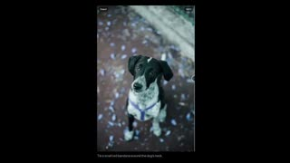
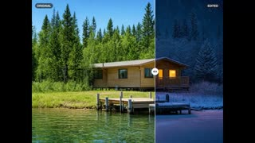
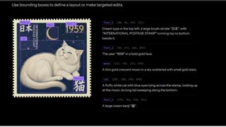

# FLUX 3 Image Klein

## What it is

BFL 5.6B open-weight image model for instruction edit, T2I, references, and bbox layout. Base and distilled checkpoints on Hugging Face; optional BFL API to 4K. Uses a separate prompt upsampler (`flux-3-image-klein-pup`) in local Diffusers or ComfyUI pipelines.

| | |
|:---:|:---:|
|  |  |
|  |  |

## Why keep

Compare or fine-tune a local open editor when you need bbox layout, multi-reference compose, or 4K-capable weights on one consumer GPU.

## When to reach for it

Self-host `black-forest-labs/flux-3-image-klein-base` (50-step, LoRA training) or the distilled Klein for 16-step edits; or call the BFL API with the same prompt and bbox format.

## Caveats

FLUX Kommunity License: non-commercial use always; commercial **output** only for Qualifying Users under $5M annual revenue; commercial fine-tuning or weight redistribution needs a BFL commercial license. Roundup ComfyUI tests reported weak faces and anatomy on the base checkpoint; community LoRAs may help. Weights are gated on Hugging Face.

## Links

- Homepage: https://bfl.ai/models/flux-3-image-klein
- Weights: https://huggingface.co/black-forest-labs/flux-3-image-klein-base
- Docs: https://docs.bfl.ml/flux_3/flux3_image_klein
