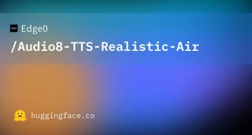

# Audio8 TTS Realistic 0.6B

## What it is

**Audio8-TTS-Realistic-0.6B** (~601M parameters plus a **44.1 kHz neural codec**) is Edge0’s **zero-shot cloning TTS** built on the DualAR architecture (Fish Audio S2 Pro lineage). It improves on **Preview 0.6B** with stronger realism, **23 languages**, and a standard **Transformers** inference path (`trust_remote_code=True`). Weights and repo are **Apache 2.0**.

| | |
|:---:|:---:|
|  | |

## Why keep

Local **multilingual speech with cloning** when preset-voice tiny models (for example Paradee) are not enough and cloud TTS cost or latency hurts.

## When to reach for it

You can run a **CUDA GPU**, need **short reference-audio cloning**, and want a compact checkpoint (~2.4 GB on Hub including codec) rather than a 30B-class speech stack.

## Caveats

Card and repo stress **consent for cloned voices** and disclosure of synthetic audio. **Realistic ONNX** is not shipped yet (Preview/0.1B ONNX paths exist separately). Quality depends on clean reference audio and transcript alignment.

## Links

- Homepage: https://edge0-ai.github.io/Audio8_TTS/realistic-0.6b/
- GitHub: https://github.com/Edge0-AI/Audio8_TTS
- Weights: https://huggingface.co/Edge0/Audio8-TTS-Realistic-0.6b
