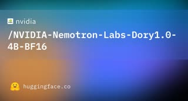

# NVIDIA Dory 1.0 4B

## What it is

**Dory 1.0 4B** is NVIDIA Nemotron Labs’ **looped (latent-recurrent)** decoder: fixed **input** and **output** blocks with a shared **recurrent** middle that runs **1–4 times per token** at inference. Input is **reinjected** each lap; the output head is trained to read state after any loop count. Weights ship as BF16, MXFP8, NVFP4, and GGUF under **OpenMDW-1.1** (commercial use allowed). English-focused, up to **256K** context.

| | |
|:---:|:---:|
|  | |

## Why keep

Pair with **nanbeige-4.2-3b** when you compare **elastic loop compute** (one checkpoint, dial depth at serve time) against a **fixed two-pass agent** tuned for tools and SWE scaffolds.

## When to reach for it

Local **vLLM** (or NVIDIA’s loop-aware builds) with **2 loops** as default; bump to **4** for harder agentic or long-context tasks when latency budget allows. Use **last-loop KV** mode when serving long context with many concurrent sequences to limit cache growth.

## Caveats

Not the same loop design as Nanbeige (full-stack double pass vs I/R/O elastic block). **Knowledge-heavy** benches (GPQA, HLE) lag larger MoEs even at high loop counts. vLLM needs **`n_recurrent_loops` per server** today (no single process with dynamic loop routing unless you run multiple instances). NVIDIA-published tables; independent AA scores may differ.

## Links

- Model card: https://huggingface.co/nvidia/NVIDIA-Nemotron-Labs-Dory1.0-4B-BF16
- Alternate formats: `NVIDIA-Nemotron-Labs-Dory1.0-4B-MXFP8`, `-NVFP4`, `-GGUF` on Hugging Face
