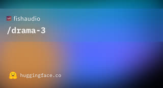
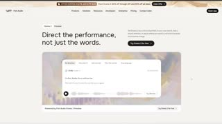
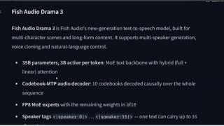
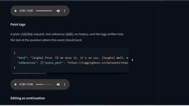

# Drama 3

## What it is

Fish Audio open-weight TTS for directed performance, voice cloning, and long-form speech. 35B MoE with about 3B active per token. You steer delivery with in-script tags and optional reference audio.

| | |
|:---:|:---:|
|  |  |
|  |  |

## Why keep

Compare when choosing a local or API TTS path that takes direction (emotion, pause, emphasis), not only read-aloud.

## When to reach for it

Local via SGLang-Omni or vLLM-Omni from the Hugging Face weights, or the fish.audio API (`model: drama-3`), when a line needs performance control or a cloned voice.

## Caveats

Fish Audio Community License, not OSI-open: free under $500k annual revenue; hosted TTS or cloning as a service needs a separate license; no cloning a real person without consent. Official serving numbers are on H200; the roundup claimed 8 GB VRAM reports. API list price is $50 per million characters (promo pricing expires 12 Nov 2026).

## Links

- Homepage: https://fish.audio/blog/fish-audio-drama-3/
- GitHub: https://github.com/fishaudio/fish-speech
- Weights: https://huggingface.co/fishaudio/drama-3
