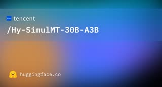

# Hy-SimulMT

## What it is

**Hy-SimulMT** is Tencent Hunyuan’s **streaming speech-to-speech translator** for **Chinese and English**: audio arrives incrementally and the model emits translated **text and speech** with low wait. Optional **voice cloning** keeps timbre in the target language. Open weights include **Hy-SimulMT-30B-A3B** (MoE-style 30B line) plus **FP8**, **GGUF**, and **interleaved** variants; **SimulInfer** adds a web UI, file upload, and WebSocket streaming.

| | |
|:---:|:---:|
|  | |

## Why keep

Benchmark or wire **live bilingual interpretation** (meetings, demos, accessibility) without a closed realtime API when you can host the stack yourself.

## When to reach for it

You need **Zh↔En simultaneous** output with spoken delivery, not post-hoc subtitles, and can budget GPU for a ~30B-class speech model (quantized builds may shrink that).

## Caveats

**Apache 2.0** on Tencent’s published code and weights; bundled third-party pieces keep their own licenses. Latency and quality depend on chunk policy and hardware; English/Chinese only in the public release. ModelScope mirrors exist if Hugging Face is awkward.

## Links

- Homepage: https://github.com/Tencent-Hunyuan/Hy-SimulMT
- GitHub: https://github.com/Tencent-Hunyuan/Hy-SimulMT
- Weights: https://huggingface.co/tencent/Hy-SimulMT-30B-A3B
