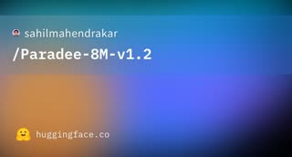

# Paradee 1.2

## What it is

**Paradee 1.2** (`Paradee-8M-v1.2`) is a small **English text-to-speech** model (~7.9M parameters) **distilled from Kokoro-82M**, shipped as **ONNX** via the `paradee` Python package and **onnxruntime** (no GPU required). v1.2 adds **four preset voices** (two US and two British). Weights and code are **Apache 2.0**.

| | |
|:---:|:---:|
|  | |

## Why keep

Drop-in **local TTS** for agents, demos, or offline apps when cloud voice APIs are too heavy or too costly.

## When to reach for it

You need **CPU-friendly speech** with a tiny disk footprint (the roundup cites ~8.5 MB class sizes for the compressed runtime) and can accept preset voices instead of custom cloning.

## Caveats

**English only** in v1.2; quality is utility-grade, not broadcast narration. Depends on **espeak/misaki** phoneme stack; verify latency and MOS on your hardware. Distilled from Kokoro; respect upstream licensing if you fork weights.

## Links

- Homepage: https://www.sahilmahendrakar.com/writings/paradee-1-2
- GitHub: https://github.com/sahilmahendrakar/paradee
- Weights: https://huggingface.co/sahilmahendrakar/Paradee-8M-v1.2
