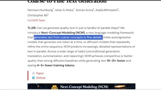
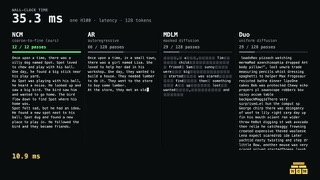
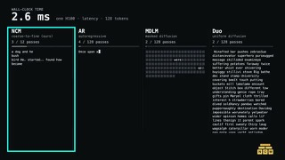

# Next-Concept Modeling (NCM)

## What it is

Stanford Scaling Intelligence Lab / **Hazy Research** framework for **parallel text generation**: a **multiscale residual VQ-VAE** builds a hierarchy of discrete codes (coarse outline to fine tokens), then a **transformer** generates **one level at a time** with **all positions within a level in parallel** (roughly **K forward passes** for K levels, not L autoregressive steps). Released at **~100M–725M** scale in the paper; not a frontier chat model. **MIT** code and task checkpoints on Hugging Face (`hazyresearch/ncm-checkpoints`, dataset `ncm-datasets`); `evaluate.py` covers XSum, WMT14 de–en, Sudoku, LM1B, TinyStories, OpenWebText.

| | |
|:---:|:---:|
|  |  |
|  |  |

## Why keep

Compare when you care about **non-autoregressive** or **diffusion-LM** alternatives: NCM targets **fewer sequential steps** and reports **10–31×** faster sampling than strong DLM baselines at matched quality on summarization and LM benchmarks, plus strong **Sudoku** vs AR/DLM at similar sizes.

## When to reach for it

Reproduce **arXiv:2610.14162** results, prototype **coarse-to-fine** decoders, or benchmark parallel generators against DLMs on the shipped tasks before scaling the idea.

## Caveats

Paper baselines are **DLMs and small AR models**, not GPT-class systems. Checkpoints are **research scale**; training your own hierarchy still needs the full two-stage pipeline. No hosted inference product.

## Links

- Homepage: https://scalingintelligence.stanford.edu/pubs/ncm/
- Paper: https://arxiv.org/abs/2610.14162
- GitHub: https://github.com/HazyResearch/ncm
- Weights: https://huggingface.co/hazyresearch/ncm-checkpoints
